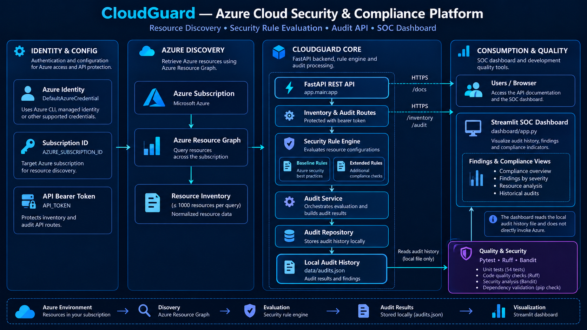

# CloudGuard — Azure Cloud Security & Compliance Platform

<p align="center">
  <strong>Azure Resource Discovery · Security Rule Evaluation · Compliance Auditing · SOC Dashboard</strong>
</p>

<p align="center">
  
  
  
  
  
</p>

## Overview

CloudGuard is a Python-based Azure Cloud Security & Compliance Platform designed to discover cloud resources, evaluate their configurations against security rules, and present audit results through a REST API and a dedicated SOC dashboard.

The platform combines Azure Resource Graph, a modular security rule engine, FastAPI services, and a Streamlit visualization layer to provide a structured view of resource inventory, security findings, and audit history.

The project emphasizes modular architecture, API authentication, automated testing, and clear separation between Azure resource discovery, security evaluation, audit persistence, and visualization.

## Architecture



### Architecture Layers

**1. Identity & Configuration**
- Environment-based application configuration.
- Azure authentication through `DefaultAzureCredential`.
- Subscription targeting through `AZURE_SUBSCRIPTION_ID`.
- Bearer-token protection for inventory and audit API routes.

**2. Azure Resource Discovery**
- Azure Resource Graph integration.
- Subscription-scoped resource queries.
- Resource normalization before security evaluation.
- A query limit of up to 1,000 resources.

**3. Security & Audit Core**
- Modular security rule engine.
- Baseline and extended rule collections.
- Structured findings with statuses and severity levels.
- Audit service for evaluation and result generation.
- Local audit-history persistence.

**4. API & Visualization**
- FastAPI REST endpoints.
- Interactive API documentation.
- Streamlit SOC dashboard.
- Historical audit visualization and compliance indicators.

**5. Engineering Quality**
- Pytest unit tests.
- Ruff code-quality checks.
- Bandit security analysis.
- Dependency consistency checks.

## Key Features

### Azure Resource Inventory
Retrieve Azure resources using Azure Resource Graph and normalize the returned resource data for downstream analysis.

### Modular Security Rule Engine
Evaluate resource configurations using baseline and extended security rules, with structured findings and severity classifications.

### Audit Processing
Coordinate security evaluations and store audit results for later retrieval and analysis.

### Authenticated REST API
Protect inventory and audit routes using bearer-token authentication. The health endpoint remains accessible without a token.

### SOC Dashboard
Visualize locally stored audit history, security findings, and compliance indicators through a Streamlit interface.

### Automated Quality Checks
Validate application behavior with unit tests and maintain code quality with Ruff, alongside security analysis with Bandit.

## Technology Stack

| Layer | Technologies |
|---|---|
| Language | Python |
| API | FastAPI, Uvicorn |
| Data validation | Pydantic, Pydantic Settings |
| Azure integration | Azure Identity, Azure Resource Graph |
| Security engine | Custom Python rules engine |
| Audit persistence | Local JSON audit history |
| Dashboard | Streamlit, Pandas, Plotly |
| Authentication | Bearer-token API authentication, Azure credential chain |
| Testing | Pytest, HTTPX |
| Code quality | Ruff |
| Security analysis | Bandit |
| Configuration | Environment variables, `.env` |

## Project Structure

```text
cloudguard/
├── app/
│   ├── api/
│   │   └── routes/
│   │       ├── audit.py
│   │       └── inventory.py
│   ├── azure/
│   │   └── client.py
│   ├── core/
│   │   ├── config.py
│   │   └── security.py
│   ├── engine/
│   │   ├── engine.py
│   │   └── rules/
│   │       ├── azure_baseline.py
│   │       └── azure_extended.py
│   ├── models/
│   ├── repositories/
│   ├── services/
│   └── main.py
├── assets/
│   ├── cloudguard-logo.png
│   └── cloudguard-architecture.png
├── dashboard/
│   └── app.py
├── tests/
│   └── unit/
├── .streamlit/
│   └── config.toml
├── .env.example
├── .gitignore
├── pyproject.toml
├── requirements.txt
├── requirements-dev.txt
└── requirements-lock.txt
```

## Local Setup

### Prerequisites

- Python 3.10 or a compatible supported version.
- An Azure subscription for live inventory operations.
- Azure credentials configured for `DefaultAzureCredential`.
- Git.

### 1. Clone the Repository

```bash
git clone <YOUR_REPOSITORY_URL>
cd cloudguard
```

### 2. Create a Virtual Environment

Windows PowerShell:

```powershell
python -m venv .venv
.\.venv\Scripts\Activate.ps1
```

### 3. Install Dependencies

```powershell
python -m pip install -r requirements-dev.txt
```

### 4. Configure Environment Variables

Create your local environment file:

```powershell
Copy-Item .env.example .env
```

Edit `.env` with your local configuration:

```dotenv
APP_NAME=CloudGuard
APP_ENV=development
DATABASE_URL=sqlite:///./cloudguard.db
AZURE_SUBSCRIPTION_ID=
API_TOKEN=
```

Set `AZURE_SUBSCRIPTION_ID` to the subscription you intend to query and configure a strong, private `API_TOKEN`.

Never commit `.env`, access tokens, credentials, or sensitive audit data.

## Running CloudGuard

### Start the REST API

From the project root:

```powershell
python -m uvicorn app.main:app --reload
```

Available local endpoints:

- Health check: `http://127.0.0.1:8000/health`
- Interactive API documentation: `http://127.0.0.1:8000/docs`
- OpenAPI schema: `http://127.0.0.1:8000/openapi.json`

### Authenticate API Requests

Inventory and audit routes require a bearer token.

Example PowerShell request:

```powershell
$headers = @{
    Authorization = "Bearer YOUR_API_TOKEN"
}

Invoke-RestMethod `
    -Uri "http://127.0.0.1:8000/<YOUR_API_ROUTE>" `
    -Headers $headers
```

Replace the example route with an actual endpoint from the API documentation. Do not put a real token in source code, screenshots, or public logs.

### Start the SOC Dashboard

Open a second terminal, activate the virtual environment, and run:

```powershell
streamlit run dashboard/app.py
```

The dashboard reads the local `data/audits.json` file. This history is intentionally excluded from version control and must be generated or populated through the application's audit workflow before historical results can be displayed.

The dashboard is a read-only presentation layer: it does not directly query Azure or trigger audits.

## Azure Authentication

The backend uses `DefaultAzureCredential`, which supports multiple Azure authentication methods depending on the environment.

For local development, authenticate using an appropriate supported credential source, such as Azure CLI, and grant it only the permissions needed to query the intended subscription.

The API bearer token and Azure credentials have separate responsibilities:

- **API token:** protects application inventory and audit routes.
- **Azure credential:** authorizes the backend to access Azure resources.

A configured API token does not, by itself, grant Azure permissions.

## Testing & Code Quality

Run the unit tests:

```powershell
python -m pytest tests/unit -v
```

Run Ruff:

```powershell
ruff check app tests dashboard
```

Check dependency consistency:

```powershell
python -m pip check
```

Run Bandit security analysis:

```powershell
bandit -r app
```

The current local validation run passed 54 unit tests, with no dependency conflicts reported by `pip check` and no Ruff findings. These results describe the validated development environment; rerun the checks after making changes.

## Security Considerations

- Keep `.env` and all real credentials out of version control.
- Use least-privilege Azure permissions.
- Protect and rotate the API bearer token.
- Keep the development server restricted to trusted environments.
- Review dashboard access controls before exposing it to other users.
- Treat audit history as potentially sensitive cloud-security information.
- Review Bandit findings instead of assuming every finding is either exploitable or harmless.

The API token protects the configured inventory and audit routes, but it does not automatically protect a separately exposed Streamlit dashboard.

## Current Scope & Limitations

- Azure resource discovery uses a query limit of up to 1,000 resources per request; complete pagination beyond that limit has not been established.
- Audit history is stored locally in JSON rather than in a demonstrated centralized database.
- The dashboard depends on the local audit-history file being available.
- Production deployment, centralized observability, and additional deployment-level access controls require separate validation.

## Roadmap

Potential future improvements include:

- Centralized and durable audit storage.
- Pagination and large-subscription inventory handling.
- More granular authorization and production deployment controls.
- Expanded security-rule coverage and integration tests.
- Automated CI checks for tests, linting, and security analysis.
- Deployment documentation and operational monitoring.

These items are proposed improvements, not claims of currently implemented functionality.

## Author

**Cherif Haouate Soulaimane**  
Cloud & DevSecOps Engineering Student

---

CloudGuard is an engineering project for Azure resource discovery, security-rule evaluation, and audit visualization. Validate all security controls and deployment assumptions before using it in a production environment.
